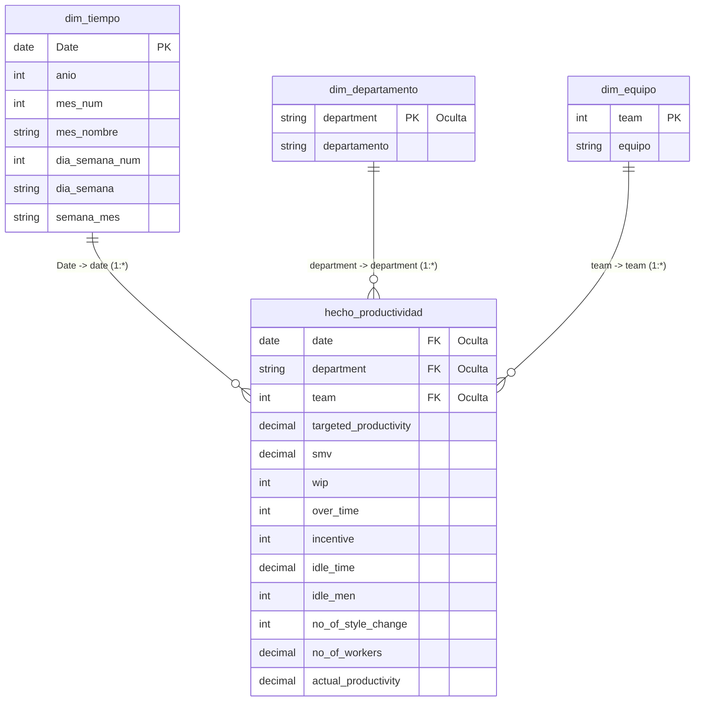

# Modelo de datos en esquema estrella — Fase 03 (`03_modeling`)

Documentación de la arquitectura del modelo analítico construido en Power BI Desktop dentro de [`04_presentation/tablero_productividad_cuellos_botella.pbix`](../04_presentation/tablero_productividad_cuellos_botella.pbix).

---

## 1. Por qué un esquema estrella (en términos de negocio)

En lugar de conectar el tablero directamente a una tabla plana con fechas, textos y métricas mezclados, el modelo separa **qué pasó** (la tabla de hechos con productividad, horas extra, tiempo muerto y WIP) de **cuándo y dónde pasó** (las dimensiones de tiempo, departamento y equipo).

Esto resuelve tres problemas reales de análisis operativo:
1. **Evita errores de calendario:** la tabla `dim_tiempo` genera los `70` días continuos entre el `2015-01-01` y el `2015-03-11` (incluidos los viernes sin actividad), permitiendo comparaciones temporales correctas y eliminando la trampa de la columna cruda `quarter` (que representaba fracciones del mes y no trimestres del año).
2. **Traduce etiquetas sin romper la trazabilidad:** los códigos técnicos en inglés (`sewing`, `finishing`, `1..12`) se mantienen como llaves internas contra `02_staging`, mientras los usuarios del tablero solo ven etiquetas limpias en español (`Costura`, `Acabado`, `Equipo 01`…`Equipo 12`).
3. **Filtros claros y sin ambigüedades:** todas las relaciones fluyen en una sola dirección (`1:*`) desde las dimensiones hacia el hecho, evitando filtros circulares y cálculos duplicados.

---

## 2. Diagrama del esquema estrella

---

## 3. Origen en Power Query

- **Consulta base:** `stg_productividad`, conectada a [`02_staging/staging_productividad.xlsx`](../02_staging/staging_productividad.xlsx) (`1.197` filas limpias verificadas en Fase 02).
- **Configuración de carga:** **Habilitar carga desmarcado** en `stg_productividad`. Sirve exclusivamente como consulta de referencia para derivar `hecho_productividad`, `dim_departamento` y `dim_equipo`, evitando duplicar almacenamiento y memoria dentro del archivo `.pbix`.

---

## 4. Detalle de tablas del modelo

### 4.1 Tabla de hechos: `hecho_productividad`
- **Volumen:** `1.197` filas × `13` columnas (`100%` de los registros de `02_staging`, sin pérdida de filas).
- **Granularidad (grano):** un registro único por **`date + department + team`** (`1.197` combinaciones únicas, `0` colisiones verificadas en Fase 02).
- **Transformación estructural:** se eliminaron `quarter` y `day` respecto a `stg_productividad`, porque esos atributos descriptivos del calendario pertenecen a `dim_tiempo`.
- **Columnas:**
  - **Llaves foráneas (ocultas en vista de informe):** `date`, `department`, `team`.
  - **Métricas operativas (10):** `targeted_productivity`, `smv`, `wip` (conservando sus `506` `null` estructurales en Acabado), `over_time`, `incentive`, `idle_time` (decimal), `idle_men`, `no_of_style_change`, `no_of_workers` (decimal) y `actual_productivity` (conservando los `37` valores `> 1`).

### 4.2 Dimensión: `dim_departamento`
- **Volumen:** `2` filas × `2` columnas.
- **Columnas:**
  - `department` (texto, llave primaria técnica — **oculta** en vista de informe): `sewing`, `finishing`.
  - `departamento` (texto, etiqueta visible en español): **`Costura`**, **`Acabado`**.

### 4.3 Dimensión: `dim_equipo`
- **Volumen:** `12` filas × `2` columnas.
- **Columnas:**
  - `team` (entero, llave primaria): `1` a `12`.
  - `equipo` (texto, etiqueta visible en español): **`Equipo 01`** a **`Equipo 12`** (formato con cero a la izquierda para garantizar orden visual natural).

### 4.4 Dimensión calendario: `dim_tiempo` (DAX)
- **Definición:** creada en DAX mediante `CALENDAR(DATE(2015,1,1), DATE(2015,3,11))`.
- **Volumen:** **`70` días continuos** sin saltos (cubre las `59` fechas con registros operativos y los días sin producción, incluidos los viernes de descanso semanal).
- **Tabla de fechas:** marcada oficialmente como **Tabla de fechas** sobre la columna `Date`.
- **Columnas y ordenamiento:**

| Columna | Descripción | Ordenamiento configurado |
|---|---|---|
| `Date` | Fecha continua (`2015-01-01` a `2015-03-11`), llave primaria | Cronológico natural |
| `anio` | Año (`2015`) | Numérico |
| `mes_num` | Número de mes (`1` a `3`) | Numérico |
| `mes_nombre` | Nombre del mes en español | Ordenado por `mes_num` |
| `dia_semana_num` | Número de día de la semana | Numérico |
| `dia_semana` | Nombre del día de la semana en español | Ordenado por `dia_semana_num` |
| `semana_mes` | Fracción semanal del mes (`Semana 1` a `Semana 5`), reemplazando la trampa semántica de `quarter` | Alfabético natural (`Semana 1`…`Semana 5`) |

---

## 5. Relaciones e higiene del modelo

### Relaciones activas (3)

| Tabla origen (`1`) | Columna origen | Cardinalidad y dirección | Tabla destino (`*`) | Columna destino |
|---|---|---|---|---|
| `dim_tiempo` | `Date` | `1:*` dirección única (`dim_tiempo` → `hecho_productividad`) | `hecho_productividad` | `date` |
| `dim_departamento` | `department` | `1:*` dirección única (`dim_departamento` → `hecho_productividad`) | `hecho_productividad` | `department` |
| `dim_equipo` | `team` | `1:*` dirección única (`dim_equipo` → `hecho_productividad`) | `hecho_productividad` | `team` |

### Higiene en vista de informe
- **Columnas técnicas ocultas:** `dim_departamento[department]` y las 3 llaves foráneas de la tabla de hechos (`hecho_productividad[date]`, `hecho_productividad[department]`, `hecho_productividad[team]`).
- **Propósito:** impedir que en la capa visual se arrastren llaves técnicas o valores crudos en inglés en lugar de las dimensiones normalizadas en español.
- **Estado del archivo:** [`04_presentation/tablero_productividad_cuellos_botella.pbix`](../04_presentation/tablero_productividad_cuellos_botella.pbix) guardado y cerrado, sin archivos temporales (`*.pbix~`, `*.pbix.lock`, `~$*`).
